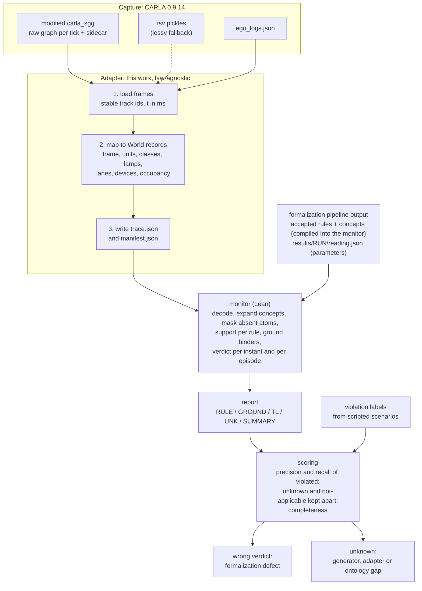

# Scene-graph adapter: the trace.json and manifest.json the monitor reads

The adapter turns one CARLA capture (scene graphs and the ego log) into two files:

- `trace.json`: what the source saw, one scene per instant.
- `manifest.json`: what the source can observe at all, per atom.

The monitor runs the formalized traffic rules over that trace and reports a verdict per rule. The
adapter knows no law. It writes everything the capture supports in the atom vocabulary, and the
manifest declares honestly what it cannot supply.

**Which contract governs: the pipeline first.** The adapter is developed for what the formalization
pipeline needs. The pipeline alone sets:
- the trace format;
- the meaning of every atom;
- what a trace may contain.

It sets them in three places: the ontology (`ontology/ATOMS.md`); Core's scene types and decoder
(`library/TrafficSpec/Core/Vocab/World.lean`, `library/TrafficSpec/Core/Runtime/Decode.lean`); and
the trace check (`library/TrafficSpec/Core/Evidence/TraceLint.lean`). The trace check is applied
to hand-written traces only: the monitor does not run it on a recorded trace (§6).

This guide describes those contracts for the adapter's developers and has no authority of its
own. Where it disagrees with them, the pipeline is right: this guide is corrected to match, and
the adapter is then changed to produce what the specs the pipeline formalizes require. A source's
limits never change the pipeline; what a source cannot supply is declared absent in the manifest.

This folder is `pipeline/evaluation/evaluation_scenario/adapter/`. Paths below that begin with
`library/`, `harness`, `results/` or `ontology/` are relative to `pipeline/traffic-spec-agent/`.

Files in this folder:

| File | What it is |
|---|---|
| `README.md` | this guide |
| `trace.example.json` | a two-scene CARLA-shaped trace; decodes with the Core decoder |
| `manifest.example.json` | a complete manifest (all 130 atom ids), written by `make_manifest.py` |
| `make_manifest.py` | writes a complete manifest from the full ontology; edit its `OBSERVED` table |

Paths below are relative to `pipeline/traffic-spec-agent/`.

## 1. How evaluation works



Step by step:

1. **Capture.** A CARLA run is recorded with the modified scene-graph generator. Use the raw graph
   (`SGG.generate_graph_for_frame()`), not the `process_to_junction_rsv` abstraction the old
   captures stored. The abstraction keeps no lane, road or junction attributes, renumbers actors
   every frame and drops yield signs. The generator also writes a sidecar per tick with:
   - the timestamp and frame number;
   - non-ego velocity, acceleration and angular velocity;
   - the ego's own lamps;
   - crosswalks and junction polygons.
2. **Adapter** (this work) writes `trace.json` and `manifest.json` (§4, §5).
3. **Monitor.** The `monitor` executable decodes both files and evaluates every registered rule:
   1. It expands concept calls and blanks every atom the manifest lists as absent.
   2. It computes each rule's support from the manifest alone: `supported`, `partial` or
      `unsupported`.
   3. It binds the rule's variables to tracks.
   4. It gives a three-valued verdict per instant and an episode verdict per binding.

   ```bash
   cd library
   lake build monitor        # only while library/splits/ACTIVE says "full" (see §7)
   .lake/build/bin/monitor --manifest manifest.json --reading ../results/<run>/reading.json --json trace.json
   ```

   It exits with status 2 on a decode error and 0 otherwise. The report has one `RULE` line per
   rule (support, absent atoms, verdict counts), `GROUND` lines (one episode verdict per binding),
   `TL` lines (runs of equal verdicts over time), `UNK` lines (why a verdict was unknown) and a
   `SUMMARY`.
4. **Scoring** (not built yet). It compares the report with violation labels from scripted
   scenarios (ScenarioRunner or our own runs) that have known violations:
   - precision and recall of `violated`, per frame and per episode;
   - `unknown` left out of the denominator and reported beside it;
   - `not_applicable` counted as its own class;
   - completeness: the share of rules supported, then of those, the share engaged.

   A miss is either a wrong verdict, which is a formalization defect, or an unknown, which is a gap
   in perception, the generator, the adapter or the ontology.

## 2. Why the adapter writes JSON, not a Lean trace module

The archive template emits a `.lean` module that defines the trace as a Lean value, which `lake`
then compiles together with the rules. The current Core reads the trace as data at run time
instead. The monitor holds exactly the same Lean value either way, a `Trace` (a list of `Scene`
records, `library/TrafficSpec/Core/Vocab/World.lean`). The rules are evaluated on that Lean value;
only the way it arrives differs.

| | Archive template | Now |
|---|---|---|
| Adapter output | Lean source defining the trace | `trace.json` |
| How it becomes a Lean `Trace` | compiled by `lake build`, for every capture | parsed by `Decode.trace` inside the compiled `monitor` |
| What is compiled | rules + the capture | rules only, once |
| Vocabulary | the generator's labels (relation constructors, proximity bands, lane node names) | the ontology's atoms (`World` records); relations are computed by Core from kinematics |
| An attribute the source did not write | read as `false` | read as unknown |

The reasons:

- **No compilation per capture.** A capture as Lean source is a very large file: the archive
  template had to split it into 8-frame chunks to get it through the compiler. With JSON, the
  monitor is rebuilt only when the rules change, and any number of captures run through the same
  binary.
- **One strict entry point.** `library/TrafficSpec/Core/Runtime/Decode.lean` is the only place an
  outside value becomes a typed one:
  - a missing key or `null` becomes "not observed", which a rule reads as unknown, never false;
  - a misspelled enumeration value or a wrong type is a decode error, never a silent default;
  - numbers decode exactly as rationals (`13.5` is 27/2), so no float rounding enters a verdict.

  A generated Lean file would bypass all three.
- **Captures stay out of the rule tree.** The formalization agents read `library/TrafficSpec/`. A
  capture compiled there would be evidence they could reach. The doctor fails the library if any
  `.json`, `.jsonl` or `.pkl` sits under it.
- **Source-neutral.** CARLA, recorded video with our perception, and hand-written tests all feed
  the same monitor. Each source differs only in its trace and its manifest.

What to keep from the archive template:
- unpickling without a CARLA install (placeholder classes for CARLA and shapely objects);
- entity identity from `carla_id` and `entity_id`, never from node names;
- half-extents from the bounding box;
- the capture precondition checks: capture rate, and replays with zero ego speed;
- the report of attributes present but not lifted.

What to drop:
- emitting Lean;
- the relation labels and proximity bands;
- "booleans only when true". Now an observed `false` must be written as `false`, because a missing
  key means unknown.

## 3. Conventions

| Topic | Rule |
|---|---|
| Frame | World frame, right-handed: +x east, +y north. CARLA is left-handed, so negate every y coordinate and y component, negate yaw, and negate yaw rate. |
| Units | metres, seconds, m/s, m/s², degrees and deg/s. `t` is an integer in milliseconds. Speed limits are in m/s (25 mph = 11.176). |
| Numbers | Plain JSON numbers, rounded to at most 6 decimals. They decode exactly, so write `8.2`, not `8.199999809`. |
| Time | `t` is strictly increasing across scenes, or the trace fails to decode. Use the simulation timestamp, not the frame number. |
| Not observed | Omit the key or write `null`. Never write `false`, `0` or `[]` for something the source did not observe. |
| Defaults | A few omitted keys are not unknown: `conditions.when_children_present` reads `false`; a time window's `start_minute` and `end_minute` read 0 and 1440; `occupancy_observed: false` reads as no track observed. |
| Key spelling | Only the keys named here are read. A misspelled or unknown key is silently ignored, so its value reads as unknown; check key names against `Decode.lean`. An intent record and a fact record are the exceptions: an extra key fails the trace (§4.1a, §4.1b). |
| Observed false | Write `false`. A brake lamp seen off is `"brake_lamp": false`. |
| Track ids | Natural numbers, stable for the whole capture: the CARLA actor id, or a fixed renumbering of it. The same physical actor keeps one id. |
| Region and device ids | Natural numbers, fixed for the whole capture. For lanes, number each (road, section, lane) triple once. Regions and devices share no id space with tracks, but each id must be unique within its own kind (structures, devices). |
| Static map | Repeat every structure and device in **every** scene. A rule sees only what a scene lists; a lane missing from a scene is absent at that instant. |
| Subject | `subject` is the ego's track id, in every scene. |
| Enumeration spellings | Exactly as the `ofString` tables in `library/splits/full/TrafficSpec/Core/Vocab/Ontology/*.lean` spell them (§4.6). |

## 4. trace.json

```
{ "scenes": [ Scene, Scene, ... ] }        non-empty, t strictly increasing
```

### 4.1 Scene

| Key | Type | Meaning |
|---|---|---|
| `t` | integer, **required** | instant of observation, ms |
| `subject` | track | the ego: the road user the rules judge |
| `users` | [RoadUser] | road users present at this instant |
| `structures` | [Structure] | lanes and other regions (the static map, repeated) |
| `devices` | [Device] | signals and signs (repeated, with their current state) |
| `occupancy_observed` | `true` / `false` / [track] | whose occupancy was observed: `true` means every user in this scene. For those tracks, a region not listed in `occupies` is *not* occupied. For any other track, occupancy is unknown. |
| `occupies` | [[track, region]] | a user's footprint overlaps the region. The footprint is the oriented box from position, heading and extent; compute it against each region's polygon. |
| `relations` | [Relation] | optional measured relations; Core computes them from kinematics when absent (§4.5) |
| `env` | Env | weather, light, calendar |
| `assumptions` | [["asm.<name>", bool]] | legal facts no sensor sees (a through highway, a business district), supplied from scenario metadata only; omit when unknown. Each id at most once per scene; the ids and their meanings are the reading's `declarations` (§4.1a) |
| `intents` | [Intent] | declared intentions, per road user and target region (§4.1a); omit a pair whose plan the source does not know |
| `facts` | [Fact] | declared facts, per id and subjects (§4.1b); omit a fact the source does not decide for those subjects |
| `links` | [[old_track, new_track]] | a track re-identified after a break; CARLA ids never break, so leave it empty. Accepted links are one-to-one: no track continued twice, none continuing two |

### 4.1a Declared intentions (`intents`)

An Intent record has exactly these keys; a missing or an extra key fails the trace:

| Key | Type | Meaning |
|---|---|---|
| `vehicle` | track | the road user whose plan is declared; a track of this scene's `users` |
| `target` | region | the region the plan concerns; a structure of this scene |
| `source` | non-empty string | where the declaration comes from: `authored_scenario` (a condition of the test, set by the scenario's author), `controller_plan` or `controller:<method>` (the recorded active plan of the driving system; `<method>` names how the controller plans its path) or `inferred_from_path` (a proxy read from the motion). Core does not read it; the evaluation reports verdicts on `inferred_from_path` traces apart and never counts them as evidence of intention independent of the behaviour |
| `values` | [["int.<name>", bool]] | each id at most once; an id is `int.` followed by `[a-z0-9_]+` |

What a value means, the same for every id:
- **true** where the source's current plan for that road user includes, at that target, what the id means;
- **false** where the plan decides that what the id means does not hold there: another manoeuvre, passing through, a manoeuvre cancelled, or one the plan has completed;
- an **id left out** wherever the plan does not decide its meaning, even when other ids of the pair are listed: what a plan does not mention is unknown, never false;
- the **pair absent** where the source has no current plan for that road user at that target, or does not know it. Never write false for a road user whose plan you do not know.

The value follows the plan, never the motion: a manoeuvre blocked, delayed or under way stays true while the plan holds it. A record is read per scene, with no carry-forward: repeat the current record in **every** scene where the source has a declaration for the pair. A scene without the record reads unknown, and a changed record counts from the first scene that carries it. A rule reads a declaration only at the observation it judges or before it. State in the report whose intentions the trace supplies (the ego only, or every road user).

**Which ids.** The ids a trace must supply, `asm.*`, `int.*` and `fact.*` alike, and what each means, are the reading's `declarations` (`library/TrafficSpec/Readings/<run>.json`), entered as the plan proposes them and reviewed by the operator. An id the reading does not list is never written.

**Admission.** A trace is rejected before any rule reads it, with every defect named, when an intent record names a vehicle not among the scene's users or a target that is no structure of the scene, when a scene has two records for one (vehicle, target) pair, an id twice in one record or twice in `assumptions`, an ill-formed id, or when two accepted links continue or are continued by one track. The monitor then exits with code 2.

### 4.1b Declared facts (`facts`)

A declared fact is a fact no sensor sees and no road-user class decides, which a scene source can
confirm: a road user's role or duty at the time (on official duty, at work on the way), a permit or
privilege it holds, an assignment (the route a bus serves, a terminus of it at a place), its
membership of a procession, a consent between two road users, an emergency its conduct answers to,
or what the map records state of a region (the named street segment a sidewalk lies on). A Fact
record has `id` and `value` and no key but `users` and `regions` besides; any other key fails the
trace:

| Key | Type | Meaning |
|---|---|---|
| `id` | string, **required** | `fact.` followed by `[a-z0-9_]+`; an id of the reading's `declarations` |
| `users` | [track] | the road users the fact is of, in the order its meaning names them; tracks of this scene's `users` |
| `regions` | [region] | the region the fact is of, at most one; a structure of this scene |
| `value` | bool, **required** | the source's declaration |

A record names one or two subjects, distinct, at most one of them a region: one road user, two road
users, a road user and a region, or a region alone. The subjects the record names are those the
id's catalogue entry states (`subjects`: `user`, `user_pair`, `user_region` or `region`); the pair's
order is the order its meaning names them, and the record of the reversed pair is another fact.

The catalogue entry of each `fact.*` id in the reading's `declarations` gives its `meaning`, its
`kind`, its `subjects` and two evidence statements, which govern every value written:
- write **true** only where the source holds what `true_when` states: a record of the scenario, the
  dispatch, the permit or the map, independent of what the road user displays;
- write **false** only where the source holds a record that excludes the fact, as `false_when`
  states (the scenario states the vehicle is on no duty, the map records place the region outside the
  segment); the absence of a record that states the fact is never a reason to write false;
- **omit** the record everywhere else; the rule is then unknown wherever the fact can change its
  verdict, and decided wherever it cannot.

A road user's own displays never decide a fact: a lit warning lamp, a siren, hazard lamps or a hand
signal is written as that signal (§4.4) and is never a reason to write a duty or an emergency
true. There are two families, kept apart by the entry's `kind`:
- **Temporary facts about road users** (kinds `duty`, `permit`, `assignment`, `membership`,
  `consent`, `emergency`): written per scene for as long as the source's record holds; repeat the
  record in every scene it holds, as for intents (no carry-forward); a change counts from the first
  scene that carries it.
- **Map records about a region** (kind `map_record`, `regions` only): static, from the map's records
  with their provenance, never derived from a sign. Write the same value in every scene where the
  region appears (a change between scenes fails the trace); write **false** explicitly for every
  region the records place outside (one per segment outside, not left out); a region a boundary of
  the records crosses is split at the boundary in the map, or its fact is left out.

**Admission.** A trace is rejected when a record names a road user not among the scene's users or a
region that is no structure of the scene, names no subject or more than two, two regions, one road
user twice, an ill-formed id, when a scene has two records for one id and the same subjects, or when
a fact of a region alone is written both true and false.

### 4.2 RoadUser

| Key | Type | Meaning |
|---|---|---|
| `track` | natural, **required** | stable id |
| `classes` | [class] | the classes this user has. **Closed world**: any class not listed is *false* for this user, unless it is in `unobserved_classes`. Omit `classes` entirely when the source cannot classify. |
| `unobserved_classes` | [class] | classes the source cannot tell for this user (for example `taxicab`): unknown, not false |
| `emergency_kind`, `official_kind` | enum | `police`/`fire`/`ambulance`/`other`; `tow`/`utility`/…/`postal`/`other` (`postal`: a vehicle in postal service, by its livery) |
| `e_bike_class`, `occupants` | natural | `occupants`: the number of persons in or on the vehicle (`ru.occupant_count`). A source that observes a person arriving at or leaving a vehicle but not the total omits it and declares `ru.occupant_count` `absent` |
| `unladen_mass` | number, kg | the vehicle's mass as built and equipped, without load, occupants or a drawn vehicle, from a registration or manufacturer's figure the source records (`ru.unladen_mass`); a combination tracked as one body writes the sum of its units. Never estimated from the bounding box. Absent: unknown, and the atom is declared `absent` where the source has no such figure |
| `disabled` | bool | the vehicle cannot move under its own power (broken down, wrecked, without fuel or charge), as the source records it, for example a scenario that disables an actor (`ru.disabled`). Write `false` only where the source knows the vehicle can move; never derive either value from a halt, hazard lamps or the engine state. Absent: unknown. It is not a class: never write it in `classes` |
| `posture` | {`on_seat`, `hands_on_controls`, `standing_on_deck`, `holding_another_vehicle`, `stunt`} | rider posture; booleans except `hands_on_controls` (a count). The fields are independent: write each one the source observes. A source that renders a rider as part of the machine, so that no field can vary, omits `posture` and declares `ru.rider_posture` `absent` |
| `kin` | Kin | §4.3 |
| `sig` | Signals | §4.4 |
| `sight_along_way` | [[way id, m], …] | per `highway` or `railway_track` region: the distance along that way, in each direction from its point nearest this user (on a railway track, from the level crossing of that track nearest this user), within which a vehicle on it could be seen from this user's eye; the smaller of the two directions (`st.sight_along_way`). Write it only where the adapter casts rays along the ways meeting the junction ahead, or along a railway track in both directions from the crossing ahead; otherwise omit it and mark the atom absent. A way it names that is neither a `highway` nor a `railway_track` fails the trace check |
| `road_grade` | number, ratio | the longitudinal slope of the roadway at this user's position, along its heading: positive uphill in the direction the user faces, negative downhill (`st.grade`). It is read with `kin.heading`: where the heading is unknown, Core reads the grade unknown. Write it only where this user's position and the one road it lies on are determined; where either is not unique (two roads overlap at the position, as at a grade-separated crossing), omit it, never pick one. Never copy one value of a whole road or region onto the users on it: a source that has only such values writes none and declares the atom absent. Absent: unknown |
| `road_curvature` | number, 1/m | the horizontal curvature of the roadway at this user's position (`st.curvature`); Core reads its magnitude, so either sign is accepted. Write it only where this user's position and the one road it lies on are determined, otherwise omit it, never pick one; never a whole road's or region's value copied onto the users on it. Absent: unknown |

### 4.3 Kin (kinematics)

| Key | Type | Unit | CARLA source |
|---|---|---|---|
| `position` | [x, y] | m | actor location (y negated); the body's reference point |
| `heading` | [hx, hy] | direction | (cos ψ, sin ψ) with ψ = −yaw. Unit length is recommended, not required: any non-zero length is read normalised. A zero vector reads unknown, and the hand-written trace check rejects it |
| `velocity` | [vx, vy] | m/s | `get_velocity()` (y negated) |
| `speed` | number | m/s | norm of the horizontal velocity; **write it**, Core does not derive it |
| `accel_longitudinal` | number | m/s² | acceleration projected on the heading, signed |
| `yaw_rate` | number | deg/s | `get_angular_velocity().z`, negated (counter-clockwise positive) |
| `extent` | [half_length, half_width, half_height] | m | `bounding_box.extent` (already half sizes) or the sidecar's 8 box vertices |
| `path_length` | number | m | integrate speed over time from the first scene; monotone |
| `steer_angle` | number | deg | the ego's `steer` control; ego only, so the manifest says `subject` |
| `engine_running` | bool | | not exposed by CARLA (the ego's engine always runs): omit, manifest `absent` |
| `parking_brake` | bool | | the ego's `hand_brake` control; ego only: `subject` |
| `gear` | integer | gear number | the ego's `gear`, negated when `reverse` is set; 0 is neutral; ego only: `subject` |
| `throttle` | number | fraction of full travel | the ego's `throttle` control; ego only: `subject` |
| `service_brake` | number | fraction of full travel | the ego's `brake` control; ego only: `subject` |

Today non-ego velocity, acceleration and angular velocity exist only if the modified generator
writes them. The unmodified generator stores them for the ego only. The five control keys are
ego-only by nature: write them for the ego and declare the atoms `subject` (§5), so that a rule
reading them for another vehicle reports unknown.

### 4.4 Signals (`sig`)

| Key | Type | CARLA `VehicleLightState` |
|---|---|---|
| `turn_indicator` | `off` / `left` / `right` | `LeftBlinker` / `RightBlinker`; `off` when neither is lit (both lit means `hazard`, and the indicator is `off`) |
| `brake_lamp` | bool | `Brake` |
| `hazard` | bool | both blinkers |
| `headlamp` | `off` / `low_beam` / `high_beam` | `LowBeam` / `HighBeam` |
| `position_lamp` | bool | `Position` |
| `reverse_lamp` | bool | `Reverse` (full split only) |
| `siren` | bool | `Special1` / `Special2` |
| `warning_lamps` | [{`colour`, `mode`, `facing`}] | the lit warning lamps, each key required (§4.6) |
| `hand_signal` | `no_signal` / `left` / `right` / `stop_or_slow` / `re_enter` | CARLA renders no arm signals: write `no_signal` on every road user |
| `doors_open` | [`traffic` / `curb`] | the sides with a door open, `[]` when none is open; not available in CARLA: omit |
| `horn`, `compression_brake` | bool | not available in CARLA: omit |

Write `turn_indicator` from the light state of every frame, `off` included: a rule that requires a
signal can come out `violated` only where the source says the indicator was off. Where the light
state is not read, leave the key out and mark `sig.turn_indicator` absent in the manifest. The ego's
lamps also need the modified generator.

### 4.5 Structures, devices, environment, relations

**Structure**

| Key | Type | Meaning |
|---|---|---|
| `id`, `kind` | natural, enum, **required** | `kind` from StructureKind (§4.6) |
| `boundary` | [[x, y], …] | polygon, world frame; needed for occupancy and every distance-to-region |
| `position` | [x, y] | reference point of a point-like structure |
| `lane` | {`direction` [x, y], `left`, `right` (neighbour lane ids in the same direction), `ordinal` (1 = leftmost), `count` (lanes in this direction), `leads_to` [lane ids], `enters_intersection` (the intersection region this carrier is an approach to; Entrance carriers, below), `marking_left`, `marking_right` ([type, colour]), `width` m} | on a lane, reserved lane, turn lane, centre turn lane or bicycle lane or path. `direction` and `enters_intersection` alone may also be written on a roadway, one-way roadway or shoulder a vehicle travels in (a road written without lane regions); a centre turn lane has no `direction`. `enters_intersection` is written only on an entrance carrier (Entrance carriers, below). A direction is local to its region (write a bend or a loop as segments); regions that overlap or cross may have different directions; a place no region carries a direction for has none — never infer one. `direction` may have any non-zero length: it is read normalised. A zero vector reads unknown, and the hand-written trace check rejects it |
| `unobserved_kinds` | [kind] | kinds the source cannot tell for this region; refinement-aware (Kind refinement, below) |
| `ways` | [highway region ids] | the public ways (`highway` regions) this region lies on (`st.on_way`): a lane, roadway, shoulder, crosswalk, stop line or median its road's; a junction every highway whose road connects there |
| `entrance_of` | [carrier ids] | on a `stop_line` or a `crosswalk` only: the entrance carriers (Entrance carriers, below) whose entrance into an intersection this line or crossing marks (`st.entrance_of`), exactly that entrance: the line or crossing a vehicle approaching through the carrier halts at or before, not a line near the carrier or on its way. One line may list several carriers (several lanes, or lanes and a segment or a bicycle lane beside them), and a carrier may have a stop line and a crosswalk. Write the complete list when the source observes it (`[]` when it observes that the line marks none): a carrier the list omits is then read as not marked by it. Omit the key when the source cannot tell; it is then read as unknown, never as "this carrier has no stop line". Each id is a structure in the same scene of kind `lane` or a kind refining it (reserved, turn or centre turn lane), or `roadway`, `one_way_roadway`, `shoulder` or `bicycle_lane_or_path`. The intersection is not written here: it is the carrier's own `enters_intersection`, and a rule reads both on the same carrier, so listing a roadway that carries no `enters_intersection` gives it no entrance (which intersection stays unknown) |
| others | `paved`, `opening`, `marked`, `sight_distance` (m), `reserved_class`, `turn_side`, `parking_angle`, `designation`, `angle_marking` and `axis` (Parking spaces, below), `curb_kind`, `curb_colour`, `obstruction_kind`, `entrance_kind` and `private` (Entrances, below), `railway_kind` (Railway tracks, below), `protected` | omit what CARLA lacks. `obstruction_kind` includes `sidewalk_elevator_or_chute` (a freight lift or chute opening in the sidewalk). `protected` is written on a `hose` obstruction only: `true` where a cover or bridge is laid over the hose, `false` where it lies bare; absent, unknown |

**Entrance carriers.** `enters_intersection` (`st.lane_enters`) names the intersection a directed
approach carrier runs into at its entrance end. A carrier is a lane or a kind refining it (reserved,
turn or centre turn lane), or a `roadway`, `one_way_roadway`, `shoulder` or `bicycle_lane_or_path`
the source records as a directed approach segment: the stretch one direction of travel uses to
reach one junction, with its entrance end at that junction.
- Writing `enters_intersection` on a roadway, one-way roadway, shoulder or bicycle lane or path
  asserts that it is such a segment. A whole two-way roadway or bicycle path, with an end at each
  junction, carries none; which junction it is an approach to is then unknown. The hand-written
  trace check cannot tell a whole two-way carrier from a segment, so it does not reject one written
  with `enters_intersection`: getting this right is the adapter's responsibility.
- Where the source can separate a two-way road's directions, write one segment per direction, each
  entering the junction its direction reaches. Each segment keeps its kind: none is relabelled
  `one_way_roadway` for having a direction, and no lane is written where the road has none. The two
  segments may cover the same pavement, so a body on it occupies both.
- A carrier enters one intersection at most. The value is decided where the source records it,
  whether or not the carrier's `direction` is written.
- It is the source's record, never inferred from distance, overlap or a road user's motion. A carrier
  never takes the entrance, the `entrance_of` line or the `governs` of a carrier it overlaps.
- A bicycle lane or path stays `bicycle_lane_or_path`: never label it `lane`. Its line, and a
  device's `governs` naming it, are its own: write them on the bicycle carrier, and they do not pass
  to the lane beside it, nor the lane's to it. A line across both lists both.
- Which carrier a road user approaches an intersection through is not written in the trace: a rule
  reads it as a carrier the road user occupies whose `enters_intersection` is the intersection the
  rule concerns, never from the road user's velocity or heading. So `occupies` and
  `enters_intersection` must be right for every carrier a body touches.

**Alley junctions.** A junction where an alley meets another way (a street, road, highway or alley)
is no intersection (`st.intersection`): write it as `driveway_or_alley_entrance`, never as
`intersection`. No carrier's `enters_intersection` names it, and no stop line or crosswalk lists a
carrier in `entrance_of` for its entrance into that junction: both keys name an entrance into an
intersection.

**Entrances.** A `driveway_or_alley_entrance` carries two keys of its own:

| Key | Type | Meaning | Absent |
|---|---|---|---|
| `entrance_kind` | `driveway` / `private_road` / `alley` / `property` | what meets the highway there: a driveway serving one property, a private road serving several, an alley, or an entrance into abutting property (a lot, a garage, a parking area) that is none of these (`st.driveway_or_alley_entrance` **kind**) | which of them it is is unknown |
| `private` | bool | the way or property the entrance leads into is private (`true`) or public (`false`), as the source's map records it (`st.driveway_or_alley_entrance` **private**) | unknown; never derive it from `entrance_kind`: an alley or a private road may be either |

**Parking spaces.** A `parking_space` carries two keys besides `parking_angle` and `designation`:

| Key | Type | Meaning | Absent |
|---|---|---|---|
| `angle_marking` | bool | `true` where the source confirms that the space's markings are an official marking indicating the angle of parking, `false` where it confirms that they are not (`st.parking_space` **angle_marking**). Never derived from the space's outline, its `axis` or its `parking_angle` | unknown |
| `axis` | [x, y] | the undirected direction of the space's long axis as its stall lines mark it (`st.parking_space` **axis**): observed from the stall lines the source records for that space (a map's or an annotation's line geometry: the direction of the space's side lines), never from a vehicle parked in it, from a design default or from a template; a source with no stall-line record omits it. Any non-zero length; a vector and its opposite are the same axis, so either may be written: Core reads the axis undirected, as the one of the two whose y component is positive, or, where y is zero, whose x component is positive, so both spellings give the same reading and the same verdicts. It is read as the angle of parking a marking indicates only where `angle_marking` is `true`; elsewhere it is the stall's geometry and nothing more. A zero vector reads unknown | unknown |

**Impassable sections.** An `impassable_section` region is a stretch of sidewalk, or of the ground
beside a roadway where a pedestrian would walk, that a pedestrian cannot traverse on foot (missing,
broken, closed or too narrow), written with its boundary where the source records one. It is not an
`obstruction`: no object need be there. A place with no sidewalk mapped is not written as one.

**Railway tracks.** A `railway_track` region is the outline of a track's outermost rails along its
length, on, beside or across the highway, so that the distance from a body to the nearest rail is
`st.region_geometry` to that region; a level crossing stays its own `railway_crossing` region where
the track meets the roadway. `railway_kind` is `railroad` or `streetcar` (`st.railway_track`
**kind**); absent, which it is is unknown. A track is written whether or not a rail vehicle is on it.

**Kind refinement.** Some kinds refine another (`StructureKind.parent?` in
`library/TrafficSpec/Core/Vocab/Ontology/Structure.lean`):

| Kind | Refines |
|---|---|
| `one_way_roadway` | `roadway` |
| `reserved_lane`, `centre_turn_lane`, `turn_lane` | `lane` |
| `roadway`, `lane`, `shoulder`, `intersection`, `bicycle_lane_or_path` | `travel_region` (abstract) |

- Label each region with its most specific kind. A region of a refining kind counts as its parent:
  a `turn_lane` is a `lane`, and a rule over lanes ranges over it. Do not write a second region for
  the parent.
- A parent never implies a refining kind, and two kinds refining one parent never imply each other.
- `travel_region` is abstract: the union of the kinds a device can govern. Never write it as a
  structure's `kind` or in `unobserved_kinds`; admission refuses either ("an abstract kind"). Label
  the region with its concrete kind. It is not the extent of a highway: a sidewalk, a crosswalk or a
  stop line is no travel region.
- `unobserved_kinds` is refinement-aware:
  - a kind that refines nothing concrete (for example `lane`, whose only parent is the abstract
    `travel_region`), listed there, leaves the region's membership
    of that kind, and of every kind refining it, unknown;
  - a refining kind (for example `turn_lane`) applies only to a region labelled with it or with a
    kind it refines (`lane`). On any other region it is ignored, and that region is known not to be
    one;
  - an unobserved refining kind never makes its parent unknown: a region labelled `turn_lane` that
    lists `turn_lane` is still a lane.
- Example: a source that cannot tell turn lanes labels them `lane` and lists `turn_lane` in
  `unobserved_kinds`. Those regions are lanes whose turn-lane membership is unknown; a crosswalk is
  still known not to be a turn lane. Declaring `st.turn_lane` absent in the manifest has the same
  effect.

CARLA mapping:
- **Lanes.** Group waypoints by (road id, section id, lane id) and take the union of their polygons
  as the boundary. `direction` is the waypoint forward vector, with y negated. Use
  `lane_change` / `get_left_lane()` / `get_right_lane()` for the neighbours. Map markings as
  Broken → `broken`, Solid → `solid`, SolidSolid → `double_solid`, BottsDots → `dotted`,
  Curb → `curb`, NONE → `none`.

  Open question: CARLA's SolidBroken and BrokenSolid both map to `solid_broken`, and the spelling
  does not say which side is solid. Ask before relying on it.

  `enters_intersection`: the id of the intersection structure whose `carla.Junction` contains the
  lane's successor waypoint (`waypoint.next(d)[0].junction_id`, or the generator's
  `waypoint_junction_id` of the next driving node). A lane inside a junction has none. Together
  with `governs` this is how a rule reads which intersection a signal controls: the device governs
  the lane, the lane enters the intersection.
- **Intersections.** `carla.Junction.bounding_box` as a polygon. It is a superset of the junction,
  so the manifest says `estimate:junction_bounding_box`.
- **Crosswalks.** `Map.get_crosswalks()`, one polygon per closed loop of points.
- **Stop lines.** From the traffic lights' `get_stop_waypoints()` and the stop-sign trigger volumes,
  as a thin polygon across the lane (an estimate). A stop line is written where it is in place; its
  paint condition (clarity, wear) is not reported, and a rule reads a represented stop line as the
  clearly marked one.
- **Entrances.** A stop line taken from a traffic light's `get_stop_waypoints()` or a stop-sign
  trigger volume lists the lanes of those stop waypoints, as (road, section, lane) ids. A crosswalk
  lists the lanes whose last waypoint before the junction lies just before it, where the map makes
  that unambiguous; where it does not, omit `entrance_of` for that crosswalk. Coverage of this key on
  CARLA is not promised: an omitted key is unknown, which is missing evidence, never a pass.

**Device**

| Key | Type | Meaning |
|---|---|---|
| `id`, `kind` | natural, enum, **required** | `kind` from DeviceKind (§4.6) |
| `position` | [x, y] | |
| `unobserved_kinds` | [kind] | device kinds the source cannot tell for this device |
| `governs` | [region ids] | the travel regions whose traffic the device controls: the lanes (`controlsTrafficOf` edges, or the landmark's affected waypoints), a bicycle lane or path, or a roadway, one-way roadway or shoulder written without lane regions; or the intersection, where the source reports the device as controlling the junction itself (read as that and nothing more). Never a highway, a controlled-access region or a region no vehicle travels in. Write `[]` when the source observes that the device governs nothing; omit the key when the source cannot tell (read as unknown) |
| `governs_sidewalk` | [region ids] | on a `regulatory_sign` whose `code` is `bicycles_prohibited` or `bicycle_ebike_escooter_prohibited` only: the `sidewalk` regions the sign governs, as the source records them (`dev.governs_sidewalk`). Write the complete list where the source records them (`[]` where it records that the sign governs none); omit the key where it does not record them, which reads unknown. Never derive it from the sign's position, a distance, or the lanes in `governs`. Admission refuses the trace when the key names a region that is not a `sidewalk` of the scene, or when it names any region on another device or another code (an absent `code` included) |
| `governs_parking_space` | [region ids] | on a `regulatory_sign` whose `code` is `angle_parking` only: the `parking_space` regions the sign governs, as the source records them (`dev.governs_parking_space`); written and refused as `governs_sidewalk` is, with `parking_space` for `sidewalk` |
| `legend_angle` | number (degrees) or `"none"` | on an `angle_parking` sign: the angle of parking its legend states, or `"none"` where the source confirms that the legend states no angle (`dev.regulatory_sign` **legend_angle**). Omit the key where the source does not read the legend's angle: that is unknown, never `"none"` |
| `indications` | [indication] | what a signal shows now. CARLA `TrafficLightState`: Red → `circular_red`, Yellow → `circular_yellow`, Green → `circular_green`, Off → `dark`, Unknown → `unknown`. |
| `speed_value`, `speed_kind` | m/s, `maximum`/`minimum`/`structure_maximum`/`zone` | speed-limit landmarks: the value converted from the landmark unit to m/s |
| `inoperative`, `flashing`, `active`, `uncovered`, `ped_state`, `countdown`, `lane_control`, `zone_kind`, `is_end`, `rail_lights`, `gate`, `bell`, `human_role`, `human_indication` | | see `Decode.lean`; omit what CARLA lacks. `human_role` includes `fire_official`, the fire department official in command at a fire; never write another role for that person |
| `code` | SignCode | a `regulatory_sign`'s catalogue code (`dev.regulatory_sign`). Two codes need a reading of the legend: `lamps_on` for a sign directing vehicles' lamps to be lit, `parking_permitted` for a sign permitting parking (write its hours, duration or class in `conditions`); both need `governs` naming the regions the sign applies to. `bicycle_ebike_escooter_prohibited` is a sign prohibiting riding a bicycle, an electric bicycle or an electric scooter, exactly these three; `bicycles_prohibited` concerns bicycles alone, and neither is written for the other. Absent: the code is unknown, never read as a different code |
| `conditions` | {windows, min_occupancy, …} | a sign's legend as read: `{}` for a sign known to state no restriction (the regulation holds at every time and for every road user); omitted only when the legend is not read, which leaves every condition on the sign unknown. Never omit it for a sign known to be unconditional. |
| `on_track`, `red_flashing`, `amber_flashing`, `stop_arm` | | full split only (school-bus signal) |

CARLA mapping:
- traffic-light actors → `traffic_signal`;
- stop landmarks or `traffic.stop` actors → `stop_sign`;
- yield landmarks → `yield_sign`, which the abstraction dropped;
- speed-limit landmarks → `speed_limit_sign`.

**Env**: `darkness`, `precipitation`, `wet_road`, `ice_or_snow` (bool), `visibility` (m) and
`civil_time` {`year`, `month`, `day`, `weekday` (0 = Monday), `minute_of_day`}. A boolean the
adapter derives from a CARLA weather parameter is a classification, so declare it as `estimate:` in
the manifest. CARLA has no calendar: omit `civil_time` unless the scenario sets one.

**Relation** (optional): `a`, `b` (tracks, required), `centre_distance`, `surface_gap`
[longitudinal, lateral], `a_ahead_of_b`, `longitudinal_overlap`, `oncoming`, `same_direction`,
`bearing`, `contact`, `visible`. Core computes all but `visible` from positions, headings and
extents when they are absent, so a simulator source writes none of those. `surface_gap` is the gap
between the nearest points of the two bodies (`rel.surface_gap`), each footprint read with its own
heading and extent, given as its lengths along and across `a`'s heading: both components are
non-negative, and both are zero when the bodies touch or overlap. A supplied `surface_gap` with a
negative component reads unknown, never as its magnitude, as zero or as contact, and the
hand-written trace check rejects it. A signed overlap belongs to `longitudinal_overlap`: the length
the two footprints' projections on `a`'s heading share, negative for the gap between those
projections. `visible` is never
computed: write one relation `{a: ego, b: actor, visible: ...}` per actor from the generator's
`is_visible_from_ego` (a ray cast from the ego to the actor's bounding box, run only when the
generator's `check_occlusion` is set), and declare `rel.visible` as `subject` in the manifest —
the generator tests sight from the ego alone. Without `check_occlusion` there is no line-of-sight
test: write no `visible` and declare the atom `absent`.

### 4.6 Enumeration spellings

The `ofString` tables in `library/splits/full/TrafficSpec/Core/Vocab/Ontology/*.lean` are the
authority. The ones CARLA needs:

- **RoadUserClass**: `motor_vehicle`, `motorcycle`, `moped`, `bus`, `transit_bus`, `school_bus`,
  `taxicab`, `tour_or_shuttle_bus`, `limousine`, `truck`, `commercial_motor_vehicle`,
  `trailer`, `vehicle_combination`, `bicycle`, `electric_bicycle`, `electric_scooter`,
  `pedestrian`, `pedestrian_with_white_cane_or_guide_animal`, `child`,
  `emergency_vehicle`, `fire_apparatus`, `official_vehicle`, `tow_car`,
  `rail_vehicle`, `trimobile`. `tour_bus_or_limousine` and `trailer_or_combination` no longer exist: a tour or
  shuttle bus is `tour_or_shuttle_bus`, a limousine `limousine`; a drawn unit tracked on its own is
  `trailer`, a drawing vehicle and what it draws tracked as one body `vehicle_combination` (beside
  the drawing vehicle's own classes). `tow_car` is a vehicle built or equipped for towing or roadside
  assistance, read from its equipment; a tow vehicle in official or contracted service is also
  `official_vehicle` with `official_kind` `tow`. `emergency_vehicle` is an authorized emergency
  vehicle: write it only where the source confirms that the vehicle is equipped with the warning
  lamps and the siren the jurisdiction requires of such a vehicle (the pipeline trusts that and
  checks no evidence of the equipment). It never says that a lamp is in use, that the vehicle is
  responding to an emergency or that it is performing an official duty: the trace shows those
  through `sig` and the vehicle's conduct. Data exported before this contract (2026-11-18) does not
  carry this meaning: its `emergency_vehicle` entries count only once its source confirms the
  equipment, and until then the adapter lists the class in `unobserved_classes`. A class whose contract
  states a legal classification is written only where the source confirms that the road user is of
  that kind under the definition the contract cites (the pipeline trusts that and checks no evidence
  of it): `bicycle` (NRS 484A.025), `moped` (NRS 484A.125 and NRS 486.038), `motorcycle`
  (NRS 484A.135), `trimobile` (NRS 486.057), `bus` (NRS 484A.030), `school_bus` (NRS 484A.230),
  `taxicab` (NRS 484A.270), `tour_or_shuttle_bus` (LVMC 11.02.150), `truck` (NRS 484A.305),
  `electric_bicycle` (NRS 484B.017), `electric_scooter` (NRS 484B.018, NRS 484A.082 and
  NRS 482.0295), `pedestrian` (NRS 484A.165) and `emergency_vehicle` (NRS 484A.020). For
  `bicycle`, `moped`, `trimobile`, `truck`, `electric_bicycle`, `electric_scooter`, `pedestrian`
  and `emergency_vehicle` the contract also states completeness: the class is written for every road
  user the source so confirms, beside any other class it writes for that road user (a person in a
  motorized wheelchair is `pedestrian` whatever else it is), and is listed in `unobserved_classes`
  for a road user the source cannot decide; a complete class list without it then means not a
  member. No class implies another: `school_bus`, `transit_bus` and `tour_or_shuttle_bus` list `bus`
  as well only where the source confirms a bus under NRS 484A.030, and `trimobile` lists
  `motorcycle` as well only where the source confirms a motorcycle under NRS 484A.135. A
  `taxicab`'s markings describe the class and are no evidence of the passenger count or the charge
  NRS 484A.270 states. `trimobile` is a motor vehicle with handlebars and a saddle seat designed to
  travel with three wheels on the ground, at least one power driven; a motorcycle with a sidecar is
  not one. Data exported before this class (2026-11-18), delivery 1108
  among it, does not classify trimobiles: its manifest does not list `ru.trimobile`, so the atom is
  absent and every road user's trimobile membership reads unknown, never false; a later export
  that lists the atom writes `trimobile` where the source classifies a road user as one, and lists
  it in `unobserved_classes` for a road user it cannot tell. A source that cannot tell one of these
  classes lists it in `unobserved_classes` or declares it absent
- **StructureKind**: `highway`, `roadway`, `lane`, `centre_line`, `road_edge`, `shoulder`,
  `sidewalk`, `median_or_divider`, `one_way_roadway`, `intersection`, `crosswalk`, `stop_line`,
  `driveway_or_alley_entrance`, `alley`, `crest`, `railway_crossing`, `railway_track`, `controlled_access`,
  `elevated_structure`, `bicycle_lane_or_path`, `reserved_lane`, `centre_turn_lane`, `turn_lane`,
  `parking_space`, `curb_zone`, `transit_stop`, `safety_zone`, `pedestrian_grade_separation`,
  `fire_hydrant`, `fire_station_entrance`, `roundabout`, `obstruction`, `impassable_section`; the decoder also spells the
  abstract `travel_region`, which a trace never writes (§4.5, Kind refinement)
- **DeviceKind**: `traffic_signal`, `pedestrian_signal`, `lane_control_signal`,
  `speed_limit_beacon`, `crossing_warning_signal`, `stop_sign`, `yield_sign`, `speed_limit_sign`,
  `regulatory_sign`, `zone_sign`, `railway_signal_or_gate`, `temporary_traffic_control`,
  `human_direction`, `school_bus_signal`
- **SignalIndication**: `circular_green`, `circular_yellow`, `circular_red`, `flashing_red`,
  `flashing_yellow`, `dark`, `unknown`, `green_arrow(<dir>)`, `yellow_arrow(<dir>)`,
  `red_arrow(<dir>)`, `flashing_yellow_arrow(<dir>)`, where `<dir>` is `left`, `right`,
  `straight` or `u_turn`
- **MarkingType** `none`, `broken`, `solid`, `double_solid`, `solid_broken`, `dotted`, `curb`;
  **MarkingColour** `white`, `yellow`, `other`
- **TurnSide** `left`, `right`; **HeadlampState** `off`, `low_beam`, `high_beam`
- **DoorSide** `traffic`, `curb`
- Warning lamps: **LampColour** `red`, `blue`, `amber`, `white`; **LampMode** `flashing`,
  `rotating`, `steady`; **Facing** `front`, `rear`, `side`
- **Full split only** (held out of the training split): DeviceKind `school_bus_signal`; SignCode
  (`code`) `lane_use_arrow` and `turn_course_marker`

List every class whose contract the road user meets, the general one and each specific one: a truck
is `["motor_vehicle", "truck"]`, never `["truck"]` alone. A class carries no implied membership:
listing one class never stands for another, so a class left out of both lists is observed not to
apply. A CARLA car is `["motor_vehicle"]`. A CARLA bicycle is `["bicycle"]`, not a motor vehicle.
When the blueprint does not settle a class (is this car a taxicab? is this van a truck?), put that
class in `unobserved_classes`. An aggregate's reading relies on this: a class it marks covered is
taken as no evidence of membership, because every qualifying road user also carries one of the
included classes named with it. Legal words such as "vehicle" or "traffic" are never written in a
trace: the reading maps them to classes.

### 4.7 Example: the canonical trace

This is the decoder's own test, `library/TrafficSpec/Tests/Decode.lean:7-25`, abridged. The test's
trace also carries track 1's `engine_running`, `gear`, `throttle`, `hand_signal` and
`sight_along_way`, lane 7's `enters_intersection`, intersection 20 with its `ways`, and a `visible`
relation. The `#guard` lines beneath it there pin what each value decodes to.

```json
{"scenes": [
  {"t": 0, "subject": 1,
   "users": [
     {"track": 1, "classes": ["motor_vehicle"],
      "kin": {"position": [0, 0], "heading": [1, 0], "velocity": [10, 0], "speed": 10, "extent": [2.25, 0.9, 0.75]},
      "sig": {"turn_indicator": "left", "brake_lamp": null}},
     {"track": 2, "classes": ["motor_vehicle", "truck"], "unobserved_classes": ["taxicab"],
      "kin": {"position": [30, 0], "heading": [1, 0], "velocity": [0, 0], "speed": 0, "extent": [2.25, 0.9, 0.75]}}],
   "structures": [{"id": 7, "kind": "lane", "lane": {"count": 2, "ordinal": 1, "marking_left": ["broken", "white"]}}],
   "devices": [{"id": 9, "kind": "traffic_signal", "governs": [7], "indications": ["circular_red", "green_arrow(left)"],
                "conditions": {"windows": [{"weekdays": [0, 1, 2, 3, 4], "start_minute": 420, "end_minute": 600}], "min_occupancy": 2}}],
   "occupancy_observed": true, "occupies": [[1, 7], [2, 7]],
   "env": {"darkness": false, "civil_time": {"year": 2026, "month": 9, "day": 21, "weekday": 0, "minute_of_day": 450}},
   "assumptions": [["asm.business_district", true]]},
  {"t": 500, "subject": 1, "users": [{"track": 1, "kin": {"speed": 8.5}}], "links": [[3, 1]]}
]}
```

What it pins:
- `brake_lamp: null` is unknown.
- Track 2 is a truck; whether it is a taxicab is unknown.
- Track 1 is *not* a taxicab, because `classes` is a closed list.
- In scene 2, occupancy is unknown, because `occupancy_observed` is not given there.

The second scene is deliberately sparse to test absence; a real trace repeats the map in every
scene.

### 4.8 Example: a CARLA-shaped trace

`trace.example.json` holds two scenes 50 ms apart (20 Hz). The ego (track 1) is braking in lane 7
towards a red signal that governs lanes 7 and 8. A stopped car (track 2) is ahead in the same lane.
The map is repeated in both scenes:
- two lanes, with neighbours, markings and widths, both entering the intersection;
- the intersection and the stop line;
- the signal and a 25 mph limit sign (11.176 m/s).

Excerpt of the first scene:

```json
{"t": 0, "subject": 1,
 "users": [
   {"track": 1, "classes": ["motor_vehicle"],
    "kin": {"position": [60.0, -1.75], "heading": [1, 0], "velocity": [8.2, 0], "speed": 8.2,
            "accel_longitudinal": -1.5, "yaw_rate": 0, "extent": [2.44, 1.06, 0.76], "path_length": 0,
            "throttle": 0, "service_brake": 0.35, "parking_brake": false, "gear": 1},
    "sig": {"brake_lamp": true}}, "...track 2..."],
 "structures": [
   {"id": 7, "kind": "lane", "boundary": [[0, -3.5], [90, -3.5], [90, 0], [0, 0]],
    "lane": {"direction": [1, 0], "left": 8, "ordinal": 2, "count": 2, "enters_intersection": 20,
             "marking_left": ["broken", "white"], "marking_right": ["solid", "white"], "width": 3.5}},
   "...lane 8, intersection 20, stop_line 21..."],
 "devices": [
   {"id": 9, "kind": "traffic_signal", "position": [91, -5], "governs": [7, 8], "indications": ["circular_red"]},
   {"id": 10, "kind": "speed_limit_sign", "position": [20, -5], "governs": [7, 8],
    "speed_value": 11.176, "speed_kind": "maximum"}],
 "occupancy_observed": true, "occupies": [[1, 7], [2, 7]],
 "relations": [{"a": 1, "b": 2, "visible": true}],
 "env": {"precipitation": false, "wet_road": false}}
```

The ego's control keys and the `visible` relation are what the generator has for the ego alone;
the manifest declares those atoms `subject` (§5). Both lanes enter intersection 20, so the
signal that governs them controls that intersection.

## 5. manifest.json

```json
{ "source": "<name and version of the generator + adapter>",
  "reid_gap": <seconds, optional, default 0>,
  "atoms": { "<atom id>": "exact" | "estimate:<error class>" | "absent" | "subject", ... },
  "facts": [ "<fact id>", ... ] }
```

- **List every atom id.** There are 140 in the full ontology, read from
  `library/splits/full/TrafficSpec/Core/Vocab/Ontology/Ids.lean`. An id the manifest omits counts
  as `absent`, and the monitor warns that the manifest is not complete.
- `st.travel_region` is abstract: no source declares it, and its entry has no effect. Whether a
  rule reading it is supported follows the entries of the five kinds that refine it (§4.5, Kind
  refinement). `make_manifest.py` writes it `absent`.
- `exact` means the source supplies the atom as ground truth.
- `estimate:<class>` means the source supplies it with a known error type (the class is a short
  name you choose, such as `junction_bounding_box`).
- `absent` means the source cannot supply it.
- `subject` means the source supplies it for the ego (the scene's `subject`) alone: the ego's
  controls (`kin.steer_angle`, `kin.parking_brake`, `kin.gear`, `kin.throttle`,
  `kin.service_brake`) and its line of sight (`rel.visible`). The monitor keeps such an atom on
  the subject and blanks it on every other user and in every relation not taken from the ego, so a
  rule that reads it for another vehicle reports unknown.
- **Declare by capability, not by this capture.** Write `exact` for `st.crosswalk` because the
  generator emits crosswalks, even on a road with none.
- **Computed relations.** `rel.*` atoms other than `rel.visible` are computed by Core from
  kinematics, so declare them observed whenever the kinematics are.
- **Kind dependencies.** A rule that reads a region kind also needs the entries of every kind that
  kind refines (§4.5, Kind refinement): a read of `st.turn_lane` needs `st.lane` too. A rule that
  reads `st.entrance_of` also needs `st.stop_line` and `st.crosswalk`, and one that reads
  `rel.ahead_behind_in_lane` needs `st.lane`. A read of `st.lane_enters` or `st.entrance_of` depends
  on no carrier kind: it reads the carrier's record, whatever the carrier's kind (`kindDependencies` in
  `library/TrafficSpec/Core/Runtime/Manifest.lean`). An absent dependency counts as an absent atom of the rule (`partial`, or `unsupported`).
- `facts` lists the `fact.*` ids of the reading's `declarations` the source supplies, with the
  evidence their `true_when` and `false_when` ask for. An id it does not list is not supplied: every
  record of it in a trace is dropped before evaluation and reads unknown. Absent, the key supplies no
  declared fact.
- `reid_gap` is the longest tracker break, in seconds, that `links` may bridge. It is 0 for CARLA.

Make one per generator version, never per capture:

```bash
cd pipeline/evaluation/evaluation_scenario/adapter
python make_manifest.py > manifest.json     # edit OBSERVED and SOURCE first
```

Excerpt of `manifest.example.json`:

```json
{"source": "carla-0.9.14 / carla_sgg modified / adapter v0", "reid_gap": 0,
 "atoms": {"ru.motor_vehicle": "exact", "ru.taxicab": "absent", "ru.truck": "estimate:blueprint_base_type",
           "kin.speed": "exact", "kin.steer_angle": "subject", "kin.parking_brake": "subject", "rel.visible": "subject",
           "st.lane": "exact", "st.intersection": "estimate:junction_bounding_box", "st.crosswalk": "exact",
           "rel.occupies": "exact", "dev.traffic_signal": "exact", "dev.yield_sign": "exact",
           "sig.brake_lamp": "exact", "sig.horn": "absent", "env.civil_time": "absent", "...": "..."}}
```

### Why the monitor needs a manifest

A trace alone cannot tell "the source looked and it was not there" from "the source cannot see
that". Both look like a missing key or a missing entity. The manifest separates them, and the
monitor uses it in two ways:

1. **Support, before any frame is read.** For each rule, the monitor collects the atoms it reads
   (through its concepts and the rules it composes) and checks them against the manifest. A rule
   whose obligation reads only absent atoms is `unsupported` and is not evaluated at all. One that
   reads some absent atoms is `partial`, and its verdicts may come out unknown. Over all rules, the
   absent atoms in the `RULE` lines are the generator's to-do list.
2. **Masking.** Every absent atom is blanked in every scene before evaluation:
   - a class becomes unknown for every user;
   - a lamp becomes `none`;
   - a device kind is marked unobserved on every device;
   - a region kind is added to every region's `unobserved_kinds`, which leaves membership open
     only as §4.5 (Kind refinement) says: an absent `st.turn_lane` makes only the regions labelled
     `lane` or `turn_lane` unknown turn lanes;
   - a `subject` atom is kept on the ego and blanked on everyone else.

   A rule that depends on it then says unknown, never `compliant`, so a capture that cannot see
   brake lamps never looks lawful about them.

The manifest also carries `reid_gap`, which tells the monitor how far it may follow a broken
track.

## 6. Before handing a capture over

1. **It decodes.** Run the monitor on it: exit status 2 is a decode error, and the message names
   the path, such as `trace.scenes[3].users[0].sig.turn_indicator: unknown value blinking`. This
   works even before any rule is registered. Beyond decoding, the monitor applies only the
   admission checks of §4.1a.
2. **The basics hold.** The monitor does not run the hand-written trace check
   (`library/TrafficSpec/Core/Evidence/TraceLint.lean`) on a recorded trace. Apart from a `t` that
   does not increase (a decode error), nothing below is rejected for you: getting it right is the
   adapter's responsibility.
   - `t` is strictly increasing, with a step equal to the capture period (50 ms at 20 Hz).
   - Track ids are stable across scenes.
   - `path_length` never decreases.
   - Every `occupies` and `governs` id names a structure in the same scene, and every
     `entrance_of` id names an entrance carrier (a lane or a kind refining it, a roadway, one-way
     roadway, shoulder or bicycle lane or path) in the same scene.
   - `enters_intersection` appears only on an entrance carrier, and on a roadway, one-way roadway,
     shoulder or bicycle lane or path only where it is a directed approach segment (§4.5, Entrance
     carriers).
   - `entrance_of` appears only on a `stop_line` or a `crosswalk`; `governs` names only the kinds
     of §4.5; no `heading` or `direction` is the zero vector.
3. **The frame is right.** A car turning left in CARLA must show `heading` rotating
   counter-clockwise and a positive `yaw_rate` after conversion.
4. **Witness replay.** Each formalized rule comes with Lean witness scenes in
   `library/TrafficSpecWitness/**`, built with `library/TrafficSpec/Core/Evidence/Builders.lean`.
   Rebuild one of them as JSON and run it through the monitor. It must get the verdict the witness
   expects. Core has no Trace-to-JSON encoder, so this is written by hand for now.

## 7. Known limits that affect the adapter

- **Build against the full split.** The training split's decoder silently ignores five keys:
  `reverse_lamp`, `on_track`, `red_flashing`, `amber_flashing` and `stop_arm`. It rejects the
  held-out enumeration values of §4.6 (`school_bus_signal`, `lane_use_arrow`,
  `turn_course_marker`) as a decode error: an unknown key is ignored, an unknown value is not. Its
  atom list also lacks 2 ids (`dev.school_bus_signal`, `sig.reverse_lamp`), so a manifest over the
  full list is reported incomplete. Build the monitor while `library/splits/ACTIVE` says `full`.
  Swap with `python -m harness split --use full`, never by hand.
- **A kind the trace never lists is decided, not unknown.** A rule quantifies over the regions and
  devices that are listed in the trace. If the generator emits no crosswalks, "there is no
  crosswalk" is decided true even when `st.crosswalk` is `absent`. So emit every crosswalk, stop
  line and sign the map has. This needs a Core decision.
- **Rules.** The monitor checks the rules registered in `library/TrafficSpec/Index.lean`.
  `allRules` is empty until accepted nodes are integrated, so the report has no `RULE` lines yet.
  Decode checks work regardless.
- **Speed values.** A speed limit in km/h has no exact 6-decimal metre-per-second form
  (30 km/h = 8.333…). The rounding error is below 10⁻⁶ m/s.
